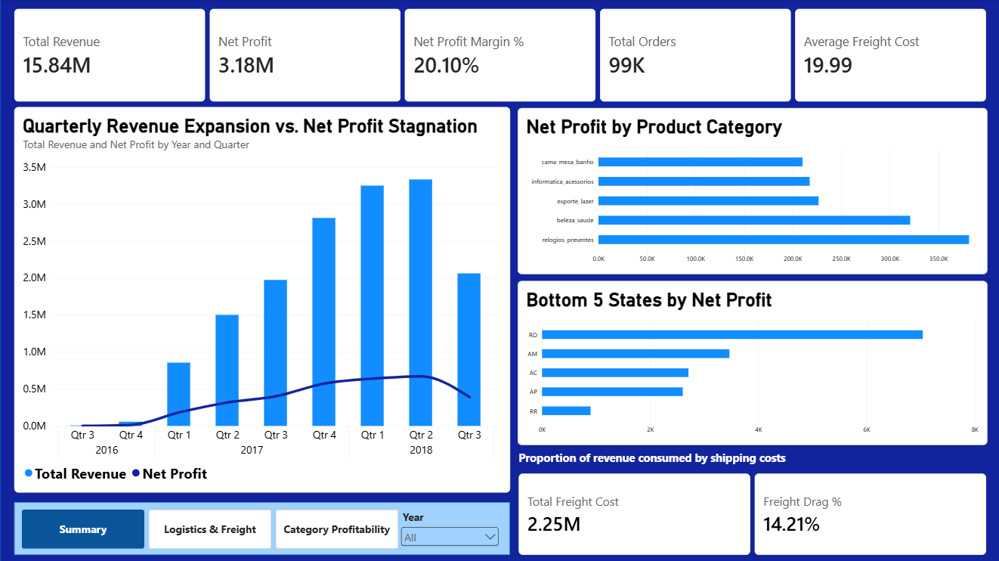

# Olist E-Commerce Analytics: Diagnosing Profit Margin Erosion

## Project Executive Summary
Despite sustained top-line revenue expansion exceeding R$3.3M quarterly peaks, enterprise net profitability experienced severe margin compression. This end-to-end data analytics solution combines relational SQL queries with Power BI modeling to uncover hidden operational cost leaks across regional logistics networks and product category mixes, delivering targeted strategic intervention points to recover bottom-line performance.

---

## Data Architecture & Analytical Stack
* **Database & Querying:** SQL (Relational data extraction, joining multi-table schemas, aggregation, and pre-cleaning)
* **Business Intelligence Tool:** Power BI Desktop (`Olist_Profit_Erosion_Analysis.pbix`)
* **Data Schema:** Star/Snowflake relational model linking Orders, Order Items, Customers, Product Translations, and Geolocation datasets
* **Core DAX Calculations:** `Total Revenue`, `Net Profit`, `Net Profit Margin %`, `Total Orders`, `Total Freight Cost`, `Average Freight Cost`, `Freight Drag %`

---

## Dashboard Architecture & Key Insights

### 1. Summary (Executive Overview)

* **Macro Revenue vs. Profit Divergence:** Tracks quarterly revenue trajectories against net profit, proving that revenue growth from 2017 to 2018 masked stagnant profit margins (~20.1% overall margin).
* **Freight Drag Warning Indicator:** Highlights an enterprise **14.21% Freight Drag Ratio**, consuming significant gross profit.

### 2. Logistics & Freight (Regional Drag Analysis)

* **High Freight Cost Leakage:** Identifies **R$2.25M** in total freight expenditure across ~99K orders.
* **Remote State Vulnerability:** Proves that distant northern/northeastern states (**RR, AP, AC, AM, RO**) suffer extreme shipping overhead where regional freight costs match or surpass net profits generated.

### 3. Category Profitability (Product Mix Dynamics)

* **Core Margin Drivers:** Pinpoints top profit contributors spearheaded by high-value categories (`relogios_presentes`, `beleza_saude`).
* **Volume vs. Profit Drag:** Uncovers high-volume, low-margin categories (`cama_mesa_banho`, `utilidades_domesticas`) that contribute high shipping drag relative to net profit.

---

## Strategic Recommendations
1. **Tiered Regional Shipping & Surcharges:** Implement minimum order thresholds or distance-adjusted shipping surcharges for remote states (RR, AP, AC, AM, RO) to stop logistics spend from eroding unit economics.
2. **Fulfillment Center Relocation:** Establish regional warehousing hubs closer to key consumer hubs to lower the per-order average shipping cost.
3. **Product Mix Optimization:** Reallocate marketing acquisition spend toward high-margin drivers (`relogios_presentes`, `beleza_saude`) while restructuring pricing on high-weight, low-margin items.
